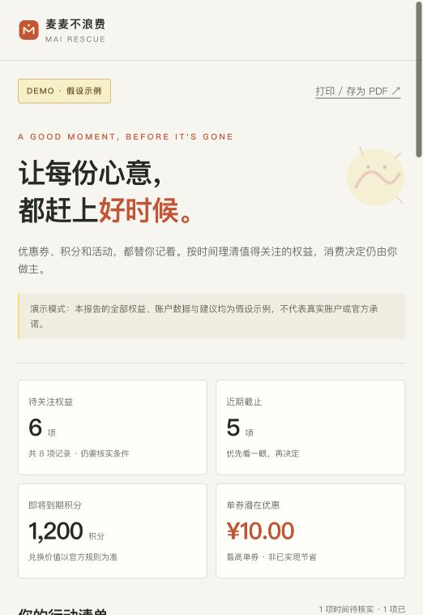

# 麦麦不浪费 · MAI RESCUE

把即将到期的优惠券、积分和当月活动整理为一份可核对的本地行动清单。先考虑是否本来就要就餐，再考虑权益；不为用券额外消费，不把积分折算成现金。

本项目是独立开发的麦当劳程序员创意开发大赛参赛准备作品，**非麦当劳官方产品，仅供个人非商业使用**。Python 3.11+，仅使用标准库，无需安装第三方依赖。

## 适合谁

- 已有麦当劳会员权益，希望集中检查截止时间的人。
- 已计划就餐，希望在自己预算内查看可用权益的人。
- 希望通过 MCP 构建可追溯、只读决策 Skill 的开发者。

## 它会做什么

读取账户优惠券、积分信息、可领券和当月活动，将每项权益分为建议处理、待核实和跳过，解释原因并保留来源；生成本地 HTML、Markdown、JSON 和日历提醒。HTML 支持筛选，演示数据有明确标识。

关键规则：已过期权益跳过；最低消费超出预算的优惠券跳过；未知截止时间进入待核实，且不生成日历提醒；没有计划就餐时，优惠券进入待核实；潜在优惠最多取一张可用券的最高明确金额，不累加券、不推断可叠加，积分始终单独呈现。

未领取券只供核实，不计入潜在优惠，也不把领取截止当成使用截止导出日历。已知优惠金额但消费门槛未知时，同样先核实。

## 30 秒离线演示

在项目根目录运行：

```sh
python3 --version
python3 -m mai_rescue demo --out demo-output --visit --budget 35
```

用浏览器打开 `demo-output/report.html`。也可以阅读 `report.md`、检查 `plan.json`，或自行将 `reminders.ics` 导入日历。**演示中全部账户、优惠券和活动均为合成数据，不是官方活动或真实账户结果。**

日历优先在截止前一天提醒；不足一天时改为截止前一小时，不足一小时则安排在剩余时间中点，少于一分钟不加闹钟。请在提醒时刻前导入文件；已过去的绝对提醒时间不会补发。日期待核实、尚未开始、已跳过和未领取券均不生成日历事件。

`--visit` 表示已经有就餐计划；省略时不会建议为用券专程消费。`--budget 35` 的单位是元。CLI 把金额转换为分计算，避免浮点金额误差。



## 真实 MCP 接入

**2026 年 10 月 25 日已完成真实 MCP 联调：发现 35 个工具，`query-my-coupons`、`query-my-account`、`campaign-calendar`、`available-coupons`、`now-time-info` 五个只读工具均返回业务 `code: 200`。** Token 由用户在本机隐藏输入，原始账户结果仅保留在 `.private/`，不公开。这是本次验证结果，不保证未来 schema 或账户状态不变。

1. 按[官方 MCP 指南](https://github.com/M-China/mcd-mcp-server)在[麦当劳开放平台](https://open.mcd.cn/mcp)自行登录、同意服务规则并申请 Token。
2. 在项目目录运行 `python3 -m mai_rescue auth`，在你自己的交互终端中隐藏输入 Token。程序保存到被 Git 忽略的 `.private/mcd-token`（权限 600）。也可以设置环境变量 `MCD_MCP_TOKEN`，环境变量优先。不要提交真实值到 GitHub、写进截图或粘贴到对话。`.env.example` 只是字段说明，程序不会自动加载 `.env`。
3. 运行环境检查和工具发现。

下面的输入操作不会把 Token 写入命令历史；输入时没有字符回显：

```sh
python3 -m mai_rescue auth
python3 -m mai_rescue doctor
python3 -m mai_rescue discover --out .private/tools.json
```

`doctor` 检查 Python 和 Token 是否配置，不输出 Token。服务地址固定为官方 `https://mcp.mcd.cn`。

4. 阅读 `.private/tools.json` 中当前工具的 `inputSchema`，据此填写 `examples/arguments.example.json`。工具名映射到其参数对象；没有必填参数时才可以使用 `{}`。本项目不假设官方未公开的参数或响应字段。
5. 使用已验证的 `official-2026-10` 适配 profile 采集并标准化，生成本地报告。

```sh
python3 -m mai_rescue sync --profile official-2026-10 --out .private/snapshot.json
python3 -m mai_rescue plan .private/snapshot.json --out .private/report-output --visit --budget 35
```

也可以先保留原始查询结果，再选择适配方式：

```sh
python3 -m mai_rescue capture --arguments examples/arguments.example.json --out .private/capture.json
python3 -m mai_rescue normalize .private/capture.json --profile official-2026-10 --out .private/snapshot.json
```

该 profile 保留账户券真实核销日期和使用时段；不会把可能代表售卖价的 `discountValue` 当成节省金额。月度待过期积分没有明确截止日时保持未知，活动展示日期不当作活动截止。真实数据中金额、门槛或期限不明确的项目仍为“待核实”，不会凭空生成优惠和日历。

优惠券查询按本次已验证结构采集最多 5 页并保留逐页来源；本次实际账户只有 1 页。超过上限或分页信息不完整时，报告保留说明，不宣称已覆盖全部权益。

需要适配新结构时，仍可使用显式映射：

```sh
python3 -m mai_rescue sync --mapping mapping.json --arguments examples/arguments.example.json --out .private/snapshot.json
```

`--profile` 与 `--mapping` 互斥。`mapping.json` 需根据真实返回结构创建，格式见 [MCP_INTEGRATION.md](MCP_INTEGRATION.md) 与 [normalization.md](skills/mai-rescue/references/normalization.md)。映射示例是项目语法示意，不代表官方 schema。缺少必填工具参数会报错，请回到 `tools/list` 补齐，不要猜测。

`sync` 同时在快照旁保存 `snapshot.capture.json` 原始结果，便于按来源路径复核；这两个文件均保留在本机私密目录。

真实用户资料、券码、Token、原始 capture、快照和报告只保存在本地 `.private/`。不得把这些内容直接放到 GitHub、截图或公开报名材料中。

## 命令速查

| 命令 | 用途 |
| --- | --- |
| `python3 -m mai_rescue doctor` | 检查运行环境和 Token 配置状态 |
| `python3 -m mai_rescue auth` | 交互终端隐藏输入本机凭证，保存到 `.private/mcd-token` |
| `python3 -m mai_rescue demo --out demo-output --visit --budget 35` | 使用合成数据生成完整报告 |
| `python3 -m mai_rescue discover --out .private/tools.json` | 查询官方工具清单与当前 schema |
| `python3 -m mai_rescue capture --arguments examples/arguments.example.json --out .private/capture.json` | 采集白名单只读工具的原始结果 |
| `python3 -m mai_rescue normalize .private/capture.json --profile official-2026-10 --out .private/snapshot.json` | 按本次已验证结构生成项目快照 |
| `python3 -m mai_rescue sync --profile official-2026-10 --out .private/snapshot.json` | 使用已验证 profile 采集并标准化 |
| `python3 -m mai_rescue normalize .private/capture.json --mapping mapping.json --out .private/snapshot.json` | 按显式映射生成项目快照 |
| `python3 -m mai_rescue sync --mapping mapping.json --arguments examples/arguments.example.json --out .private/snapshot.json` | 采集并标准化 |
| `python3 -m mai_rescue plan .private/snapshot.json --out report-output --visit --budget 35` | 生成权益行动清单 |

`plan` 支持 `--now ISO` 注入规划时点，例如 `--now 2026-10-25T12:00:00+08:00`，用于复现结果；实际使用应以本次官方查询和当前北京时间为准。

## 使用 Skill

Skill 位于 `skills/mai-rescue/SKILL.md`，附带按需读取的字段映射参考。保留整个 `skills/mai-rescue/` 文件夹，通过你所用客户端当前支持的 Skill 导入方式加载；具体入口以该客户端的现行文档为准。

在 WorkBuddy 中，请参照[官方文档](https://www.workbuddy.cn/docs/)的技能导入说明加载这个文件夹，并按比赛官方教程配置 MCP 连接器。不同版本的界面可能不同，本仓库不指定未经验证的本机安装目录。`mcp-config.example.json` 提供脱敏配置模板；先确认客户端是否支持 `${MCD_MCP_TOKEN}` 环境变量展开，若不支持，请使用客户端提供的安全凭证配置方式，切勿在公开配置里填真实值。

示例需求：

> 我今天已经计划去吃午饭，预算 35 元。请只查询我的权益，检查哪些临近到期，生成本地报告；不要领券、下单、兑换或抽奖。

没有 MCP 或 Token 时，Skill 会明确说明条件缺失，并使用标有“合成演示”的离线流程。将 Skill 导入 WorkBuddy 本身不等于已经使用 WorkBuddy 开发本项目；本项目没有伪造 `workbuddy.md`。

## 文件结构

```text
mai_rescue/                     CLI、MCP 客户端、映射、规划与报告
examples/                       显式映射和工具参数示例
skills/mai-rescue/               可加载 Skill 与映射参考
tests/                          标准库 unittest 测试
docs/SUBMISSION.md               参赛准备清单与报名模板
README.md                       项目介绍与使用方法
MCP_INTEGRATION.md               MCP 接入边界和实际调用流程
CONTEST_DECLARATION.md           官方原文参赛声明
mcp-config.example.json         仅含占位凭证的配置示例
.env.example                    本机环境变量说明
```

## 验证

无需 `pip install`，在项目根目录运行：

```sh
python3 -m unittest discover -s tests -v
python3 -m mai_rescue demo --out demo-output --visit --budget 35
```

测试验证离线决策规则、标准化和客户端协议行为；真实联调已于 2026 年 10 月 25 日单独完成。真实响应通过已验证 profile 或显式映射适配，字段含义不明时保持未知，不生成猜测的金额或截止时间。日后 schema 变化时应重新发现、核对和验证。

实现与本次验收记录见 [docs/VALIDATION.md](docs/VALIDATION.md)。原创源代码许可与官方内容权利边界见 [NOTICE.md](NOTICE.md)。

## 参赛准备

报名截至 **2026 年 10 月 25 日 23:59（北京时间）**，最终排行榜按 10 月 26 日 00:00 数据确定。真实 MCP 联调已完成；发布前仍须检查脱敏文件并确认参赛资格，详见 [docs/SUBMISSION.md](docs/SUBMISSION.md)。本交付提供报名材料模板，未替你发布仓库或提交报名 Issue。

## 使用边界与来源

仅查询下列官方只读能力：`query-my-coupons`、`query-my-account`、`campaign-calendar`、`available-coupons`、`now-time-info`。不执行领券、创建/取消订单、积分兑换或抽奖。报告和日历只在本地生成，不主动上传账户结果。

价格、权益规则、餐品信息和供应情况以麦当劳官方实时渠道为准。输出仅供参考，不构成医疗、营养或其他专业建议；实际可用性仍需按券面和门店规则核实。请合理安排饮食和消费。

官方依据：[比赛仓库](https://github.com/M-China/mcd-developer-innovation-challenge)、[完整活动规则](https://github.com/M-China/mcd-developer-innovation-challenge/blob/main/activityGuidelines.md)、[MCP 接入指南](https://github.com/M-China/mcd-mcp-server)。
